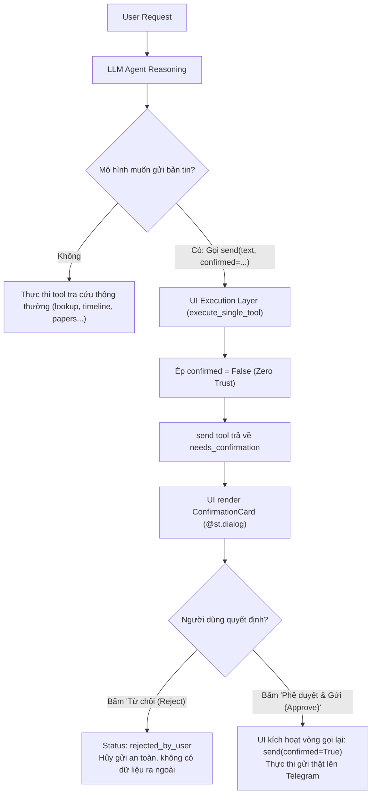

# Báo cáo cá nhân — NguyenQuangDao-2A202603614

## 1. Thông tin thành viên

- **Họ và tên:** Nguyễn Quang Đạo
- **Mã số sinh viên (MSSV):** 2A202603614
- **Email:** 26ai.daonq2@vinuni.edu.vn
- **GitHub:** [`NguyenQuangDao`](https://github.com/NguyenQuangDao)
- **Vai trò trong nhóm:** Thành viên 3 — UI, Live Demo & Report Lead (kiêm Repo Owner / Lead Architect về UI & Containerization)

---

## 2. Phần việc phụ trách

Trong dự án Day 03 Lab (Research Agent Operations Team — nhóm `top1buildphase`), tôi đảm nhiệm vai trò **Thành viên 3 — UI, Live Demo & Report Lead**, trực tiếp phụ trách các khối công việc trọng tâm sau:

1. **Xây dựng Giao diện Điều hành Agent (AI Research Operations Console — `starter_v0/app.py`):**
   - Thiết kế và lập trình ứng dụng Streamlit hoàn chỉnh (1.202 dòng mã nguồn) với kiến trúc phân lớp rõ ràng: Adapter layer (`UIProviderAdapter`), Execution engine (`run_interactive_agent_turn`), Dynamic Tool Loading và State management.
   - Hỗ trợ linh hoạt **5 nhà cung cấp mô hình (Multi-provider)**: OpenRouter, Ollama (Local), Gemini, OpenAI, Anthropic; tích hợp sẵn các preset mô hình phổ biến (Cloud lẫn Local).
   - Thiết lập cơ chế tự động xử lý lỗi thông minh (Fault tolerance): tự động thu gọn `max_tokens` (`_complete_with_bounded_tokens`) để vượt qua lỗi `HTTP 402` (credit reservation limit) trên OpenRouter và cơ chế dự phòng khi gặp `HTTP 429` (rate limit).

2. **Phát triển Bộ Custom React UI Components (`starter_v0/ui_components/`):**
   - Xây dựng component mở rộng chuẩn React + Vite + TypeScript + Tailwind CSS + shadcn/ui tích hợp hai chiều với Streamlit qua `streamlit.components.v1`.
   - Thiết kế các module giao diện chuyên dụng:
     - `WelcomeScreen`: Thẻ khởi động, thông số hệ thống và danh sách prompt gợi ý theo kịch bản.
     - `ToolCallInspector`: Trực quan hoá chi tiết từng vòng gọi tool (`round`), đối số đầu vào (arguments), kết quả thô (`result`), thời gian phản hồi (`duration_ms`) và trạng thái thực thi.
     - `ConfirmationCard`: Giao diện duyệt hành động nhạy cảm với visual hierarchy rõ ràng (kênh đích, nội dung dự kiến, nút bấm phê duyệt/từ chối).
     - `ClarifyOptions`: Giao diện tương tác nhanh khi agent gọi công cụ `clarify`.
   - Hiện thực hóa cơ chế khử trùng lặp sự kiện (`event_id` deduplication trong `consume_component_event`), triệt tiêu hoàn toàn lỗi double-trigger khi Streamlit tự động rerun.

3. **Hiện thực hóa Cơ chế An toàn 2 Lớp (2-Layer Safety Guardrail & Human-in-the-Loop):**
   - Xây dựng chốt chặn an toàn tuyệt đối cho tác vụ gửi dữ liệu ngoại vi (`send` lên Telegram):
     - *Lớp 1 (Prompt/Model):* Hướng dẫn mô hình hỏi xác nhận tường minh trước khi thực thi.
     - *Lớp 2 (UI Execution Layer - Zero Trust):* Hàm `execute_single_tool` cưỡng bức ghi đè `confirmed=False` nếu chưa có thao tác bấm duyệt từ người dùng, ngăn chặn hoàn toàn việc mô hình tự ý gửi dữ liệu ra bên ngoài.
   - Hỗ trợ quy trình phê duyệt trực tiếp: **Phê duyệt & Gửi** (`Approve & Send` → `confirmed=True`) hoặc **Từ chối** (`Reject Action` → kết thúc an toàn với status `rejected_by_user`).

4. **Đóng gói Hạ tầng, Containerization & Triển khai Cloud:**
   - Xây dựng `Dockerfile` (Python 3.11-slim, cấu hình headless, tối ưu layer cache và healthcheck).
   - Thiết lập `docker-compose.yml` phục vụ chạy ứng dụng cục bộ tức thì với một câu lệnh (`docker compose up`).
   - Cấu hình `.devcontainer/devcontainer.json` sẵn sàng cho môi trường lập trình đám mây GitHub Codespaces và VS Code Remote Containers.
   - Triển khai thành công ứng dụng thực tế lên **Streamlit Cloud** tại địa chỉ: https://k5-l3a-day03-top1buildphase.streamlit.app/.

5. **Thiết kế Poster Thuyết trình Showdown (Part A — `starter_v0/artifacts/poster.html`):**
   - Thiết kế poster kỹ thuật định dạng HTML/CSS hiện đại với phong cách giao diện tối (Dark Mode), responsive, trực quan hoá đầy đủ: sơ đồ luồng hệ thống, bảng phân loại 14 công cụ, chu trình tối ưu v0–v5, bảng so sánh metrics và 6 câu hỏi mẫu.
   - Hoàn thành làm tài liệu phụ trợ cho buổi Showdown/Debate giữa các nhóm.

6. **Thu thập Thực nghiệm, Phân tích Transcripts & Hoàn thiện Báo cáo Nhóm:**
   - Trực tiếp chạy thử nghiệm và lưu trữ 5 phiên transcript thực tế (`transcripts/*.transcript.json`) bao quát đầy đủ các kịch bản: nghiên cứu web đa bước, vòng lặp clarification, guardrail xác nhận/từ chối Telegram và tra cứu chính sách công ty.
   - Cùng Thành viên 1 phân tích log lỗi tồn đọng ở `v3`, trực tiếp đồng thực hiện và đánh giá 2 vòng tối ưu `v4` (`system_prompt.md`) và `v5` (`tools.yaml`), đưa độ chính xác lên mức tuyệt đối: **20/20 Base cases (1.00)** và **10/10 Group cases (1.00)**.
   - Đồng tác giả báo cáo chung của nhóm (`artifacts/REPORT.md` / `report/team/group_report.md`): hoàn thiện Phần A, mục B4 (Live Chat Evidence), mục B5 (Bonus Evidence: UI, Poster, Docker), và mục B6 (Reflection dưới góc nhìn Thành viên 3).
   - Điều phối và quản lý mã nguồn GitHub repository: kiểm tra và duyệt merge toàn bộ các Pull Requests của dự án (PR #1 đến PR #8).

---

## 3. Đóng góp cụ thể

### 3.1. Thiết kế và Hiện thực AI Research Operations Console (`starter_v0/app.py`)

Tôi đã xây dựng ứng dụng trung tâm `starter_v0/app.py` với quy mô hơn 1.200 dòng mã nguồn, đáp ứng tiêu chuẩn phần mềm chuyên nghiệp:

- **Kiến trúc phân tầng và bảo vệ hạ tầng:**
  - `UIProviderAdapter`: Lớp adapter bọc ngoài backend provider giúp tương thích 100% protocol gọi hoàn thành mô hình, đồng thời tự động bắt lỗi `HTTP 402` từ OpenRouter khi số lượng token dự trữ mặc định (`max_tokens=16384`) vượt quá số dư tài khoản; adapter tự động gọi lại với `max_tokens=1024` một cách minh bạch, tuyệt đối không bịa đặt tool calls hay phản hồi.
  - Hỗ trợ đa dạng nhà cung cấp: Cho phép người dùng chuyển đổi linh hoạt giữa 5 provider qua sidebar, gồm cả model thương mại mạnh (`openai/gpt-4o-mini`, `nvidia/nemotron-3.5-lightning:free`, `cohere/command-r7b-12-2024`) và model chạy local qua Ollama (`qwen2.5:7b`, `llama3.2:3b`, `qwen2.5:3b`, `llama3.1:8b`).
  - Kiểm tra trạng thái an toàn: Các hàm `check_provider_status` và `check_tool_env_readiness` kiểm tra sự sẵn sàng của API keys và dịch vụ bên thứ ba (arXiv, Policy KB, Tavily, Firecrawl, RapidAPI, Telegram) với đèn báo trạng thái xanh/vàng/đỏ mà không làm rò rỉ bất kỳ chuỗi bí mật nào lên giao diện.
- **Vòng lặp thực thi công cụ tương tác (`run_interactive_agent_turn`):**
  - Quản lý vòng lặp đa lượt (`multi-round`) giữa Model và Tool Execution, hiển thị tiến trình thời gian thực (`st.status`).
  - Đọc động toàn bộ 14 công cụ từ `artifacts/tools.yaml` và `tools/__init__.py` làm nguồn sự thật duy nhất (Single Source of Truth), tự động render bảng **Danh mục công cụ (Tool Inventory)** chi tiết ngay trên modal UI.
  - Tự động ghi lại toàn bộ nhật ký phiên làm việc theo đúng chuẩn cấu trúc JSON của `chat.py` (bao gồm `session_id`, `prompt_hash`, `tools_hash`, `turns`, `tool_events`, metrics) và lưu trữ trực tiếp vào thư mục `starter_v0/transcripts/`.

### 3.2. Phát triển Custom React Components với shadcn/ui & Tailwind CSS

Để đem lại trải nghiệm vận hành AI vượt trội so với Streamlit truyền thống, tôi đã thiết kế và biên dịch gói frontend React chuyên biệt (`starter_v0/ui_components/`):

| Thành phần | Đường dẫn mã nguồn | Chức năng kỹ thuật chính |
|---|---|---|
| **Streamlit Bridge** | `ui_components/__init__.py` | Đăng ký component hai chiều với Streamlit qua `declare_component`; triển khai cơ chế lọc sự kiện trùng lặp `consume_component_event` dựa trên `event_id`. |
| **WelcomeScreen** | `frontend/src/components/features/WelcomeScreen.tsx` | Hiển thị thẻ giới thiệu hệ thống, trạng thái kết nối provider/model, số lượng tool khả dụng (14 tools), và các nút chọn nhanh 6 kịch bản truy vấn mẫu. |
| **ToolCallInspector** | `frontend/src/components/features/ToolCallInspector.tsx` | Giao diện thanh tra toàn diện hoạt động của Agent: xem từng round, danh sách tool được gọi, trực quan hoá tham số JSON, dữ liệu raw output từ API, thời gian chạy (`ms`), và nhãn trạng thái trực quan. |
| **ConfirmationCard** | `frontend/src/components/features/ConfirmationCard.tsx` | Thẻ xác thực tác vụ nhạy cảm: hiển thị cảnh báo đỏ/vàng, tên kênh Telegram thụ hưởng, trích đoạn văn bản cần gửi, cùng 2 nút tương tác **Approve & Send** và **Reject Action**. |
| **ClarifyOptions** | `frontend/src/components/features/ClarifyOptions.tsx` | Hiển thị các phương án lựa chọn khi agent cần người dùng làm rõ (`response_type="choice"` hoặc `"yes_no"`), cho phép bấm chọn 1 chạm thay vì phải gõ bàn phím. |
| **Design System** | `frontend/src/components/ui/*`, `theme.py` | Tích hợp hệ thống component chuẩn shadcn/ui (Alert, Badge, Button, Card, Collapsible, ScrollArea, Tabs, Tooltip) và bộ theme đồng bộ màu sắc Dark/Light. |

### 3.3. Cơ chế Human-in-the-Loop & 2-Layer Safety Guardrail cho Tool `send`

Một đóng góp kỹ thuật trọng tâm của tôi là giải quyết triệt để rủi ro an toàn khi agent tự động tương tác với thế giới bên ngoài (gửi tin nhắn lên kênh Telegram):



- **Phân tích rủi ro thực tế:**
  1. *Lỗ hổng mã nguồn:* Ở phiên bản starter ban đầu, lệnh kiểm tra `if not confirmed:` trong Python coi chuỗi ký tự `"false"` là truthy, dẫn tới việc nếu mô hình nhỏ truyền chuỗi `"false"`, tin nhắn vẫn bị gửi thật ra ngoài (vượt rào).
  2. *Lỗ hổng hành vi mô hình:* Trong thực nghiệm với các mô hình local (như `llama3.2:3b` ở case R12), mô hình tự ý sinh `confirmed=True` dù người dùng chưa hề đồng ý.
- **Giải pháp bảo vệ hai lớp do tôi thiết lập:**
  - *Lớp 1 (Mô hình):* Prompt yêu cầu mô hình phải dùng `clarify(response_type="yes_no")` để xin phép người dùng trước khi gửi.
  - *Lớp 2 (Giao diện - Hard Guardrail):* Trong `starter_v0/app.py`, hàm `execute_single_tool` áp đặt quy tắc:
    ```python
    # Safety Guardrail: Never pass confirmed=True to send without explicit UI approval.
    if call.name == "send" and not allow_confirmed_send:
        call_args["confirmed"] = False
    ```
  - Khi `confirmed=False`, công cụ `send` trả về `status: "needs_confirmation"`. Ứng dụng ngay lập tức tạm dừng vòng lặp, hiển thị modal `@st.dialog` chứa `ConfirmationCard`. Chỉ khi người dùng chủ động nhấn nút **Approve & Send**, sự kiện mới gửi tín hiệu cho phép chạy vòng phụ với cờ `allow_confirmed_send=True`. Nếu bấm **Reject Action**, hệ thống hủy bỏ hành động an toàn (`status: "rejected_by_user"`).

### 3.4. Thiết kế Poster Showdown Kỹ thuật (Part A — `artifacts/poster.html`)

Tôi đã lập trình tệp poster tương tác `starter_v0/artifacts/poster.html` (640 dòng mã nguồn), hoàn thành trước deadline 16:30 của buổi học:

- **Bố cục giao diện dashboard hiện đại:** Sử dụng Dark Palette chuẩn công nghệ (`#0B0F14`, `#111821`, `#8BDBB1`, `#79B8FF`), typography rõ nét, tối ưu cho màn hình trình chiếu hoặc in ấn/trưng bày.
- **Nội dung kỹ thuật cô đọng và trực quan:**
  - Phần Header: Thông tin nhóm `top1buildphase`, đường dẫn repo và liên kết Live Demo Streamlit Cloud.
  - Phân loại 14 công cụ rõ ràng thành 3 cụm: Core Research (6 tool), Security & Grounding (4 tool), và Community & Developer Extensions (4 tool do nhóm tự phát triển).
  - Trực quan hóa quy trình **Evidence-Driven Optimization Pipeline**: Thể hiện rõ các mốc từ v0 (baseline 65%), v1 (prompt sửa 90%), v2 (tools.yaml 85%), v3 (90%), cho đến v4 & v5 (đạt tuyệt đối 100% trên cả bộ Base lẫn Group).
  - Bảng tổng hợp số liệu đo lường thực nghiệm và 6 kịch bản câu hỏi mẫu để các đội bạn thử nghiệm trực tiếp tại chỗ.

### 3.5. Đóng góp Tối ưu hóa v4 & v5 (Đạt 100% Tuyệt đối trên Base & Group Suites)

Song hành cùng Thành viên 1, tôi đã tham gia phân tích sâu log lỗi sau vòng `v3` và trực tiếp thực hiện tinh chỉnh cho hai phiên bản `v4` và `v5`:

| Phiên bản | Tệp thay đổi | Vấn đề cần giải quyết & Giải pháp | Kết quả đo đạc | Bằng chứng run file |
|---|---|---|---|---|
| **v4** | `artifacts/system_prompt.md` | **Sửa lỗi R12 & M06:**<br>- `R12`: Mô hình ưu tiên hỏi nội dung bài đăng trước khi hỏi xác nhận. Sửa prompt: Bắt buộc gọi `clarify(response_type="yes_no")` xin phép gửi trước, kể cả khi chưa có nội dung.<br>- `M06`: Lệnh hủy nguồn Twitter ở lượt trước bị mất hiệu lực ở lượt sau. Sửa prompt: Thiết lập quy tắc ghi nhớ và duy trì hiệu lực hủy/thay đổi nguồn xuyên suốt các lượt hội thoại. | **Base: 20/20 (1.00)**<br>• Routing: 1.00<br>• Argument: 1.00<br>• Multiturn: 1.00<br>(0 lỗi provider) | `runs/v4_B_base_openrouter_20261110T160309218282.json` |
| **v5** | `artifacts/tools.yaml` | **Sửa lỗi G08:**<br>- Trong trường hợp multi-turn điều chỉnh limit từ 5 lên 10 của `github_repos`, mô hình bỏ qua đối số `sort` do trong schema khai báo là trường tuỳ chọn có default. Sửa schema: Đưa `sort` vào danh sách `required: [query, sort]` và nêu rõ phải truyền tường minh giá trị `sort="stars"`. | **Group: 10/10 (1.00)**<br>**Base: 20/20 (1.00)**<br>• Routing: 1.00<br>• Argument: 1.00<br>• Multiturn: 1.00 | `runs/v5_B_group_openrouter_20261110T160406570224.json`<br>`runs/v5_B_base_openrouter_20261110T160447011852.json` |

### 3.6. Đóng gói Container, Devcontainer & Triển khai Cloud

- **Đóng gói Docker:** Soạn thảo `Dockerfile` tối ưu hóa kích thước dựa trên `python:3.11-slim`, cài đặt thư viện cần thiết, thiết lập biến môi trường headless cho Streamlit và cấu hình chỉ thị `HEALTHCHECK` kiểm tra trạng thái hoạt động tại `http://localhost:8501/_stcore/health`.
- **Docker Compose:** Cấu hình `docker-compose.yml` liên kết trực tiếp cổng `8501:8501` và nạp tự động file biến môi trường `starter_v0/.env`, cho phép bất kỳ thành viên nào hoặc người chấm bài chỉ cần gõ `docker compose up` là có ngay môi trường chạy sẵn sàng.
- **VS Code Dev Containers & GitHub Codespaces:** Xây dựng `.devcontainer/devcontainer.json` nạp image chuẩn của Microsoft, tự động cấu hình extension Python/Pylance, tự động kích hoạt `streamlit run app.py` và cấu hình forward port 8501 với preview trình duyệt tự động.
- **Deploy Cloud:** Triển khai mã nguồn lên nền tảng **Streamlit Cloud** tại https://k5-l3a-day03-top1buildphase.streamlit.app/, hỗ trợ truy cập trực tiếp phục vụ buổi chấm và demo thực tế.

### 3.7. Thu thập Thực nghiệm và Trích xuất Bằng chứng Transcripts

Tôi đã trực tiếp chạy các kịch bản tương tác và thu thập đầy đủ 5 file transcript theo chuẩn JSON trong thư mục `starter_v0/transcripts/`:

1. `live_research.transcript.json`: Minh chứng luồng nghiên cứu đa bước hoàn chỉnh (`lookup` tin tức AI thời sự qua Tavily API → trích chọn 5 tin → `format` tạo bản tin dẫn link nguồn; và tra cứu arXiv qua `papers` → lấy 3 bài preprint mới nhất về AI Agent Evaluation).
2. `live_clarify.transcript.json`: Minh chứng luồng làm rõ thông tin khi user yêu cầu tóm tắt bài đăng mạng xã hội nhưng không cung cấp tài khoản (`clarify` tạm dừng vòng lặp và hỏi người dùng → user cung cấp tài khoản → agent định tuyến chính xác tới `timeline`).
3. `live_confirmation.transcript.json`: Minh chứng cơ chế guardrail của công cụ `send` (gọi `send(confirmed=False)` bị chặn với trạng thái `needs_confirmation` → người dùng xác nhận rõ ràng → agent mới gọi `send(confirmed=True)`).
4. `v3_openrouter_20261110T105249646669.transcript.json`: Phiên tương tác trên giao diện Streamlit chứng minh cơ chế chốt chặn UI: mô hình tự ý gửi `confirmed=True` ở Round 3 nhưng UI ép xuống `confirmed=False`, người dùng nhấn nút **Reject Action** trên UI làm hủy gửi an toàn (`rejected_by_user`); ở Turn 2 người dùng nhấn **Approve & Send** thì lệnh gửi mới được cấp phép thực thi.
5. `v3_openrouter_20261110T112336428327.transcript.json`: Phiên tương tác trên giao diện Streamlit kiểm thử công cụ tra cứu chính sách công ty (`policy`) bằng tiếng Việt, bóc tách vùng tin cậy (`untrusted_text`) và trả lời chính xác, trung thực khi tài liệu không đề cập quy định trích dẫn nguồn (không bịa thông tin).

---

## 4. Bằng chứng

### 4.1. Bằng chứng Mã nguồn, Tập tin và Đóng góp Repository

| Hạng mục / Tập tin | Vị trí trong dự án | Vai trò & Đóng góp |
|---|---|---|
| **Console Application** | `starter_v0/app.py` (1.202 dòng) | Thiết kế toàn bộ giao diện điều hành agent, multi-provider adapter, token throttling fallback, guardrail execution, transcript logging. |
| **Custom UI Components** | `starter_v0/ui_components/__init__.py`<br>`starter_v0/ui_components/theme.py`<br>`starter_v0/ui_components/frontend/src/**/*` | Bộ component React + Vite + Tailwind + shadcn/ui: `WelcomeScreen`, `ToolCallInspector`, `ConfirmationCard`, `ClarifyOptions`, kèm logic khử trùng lặp sự kiện `consume_component_event`. |
| **Streamlit Configuration** | `starter_v0/.streamlit/config.toml` | Thiết lập theme màu sắc tối tân, cổng kết nối và tối ưu hiển thị headless. |
| **Hạ tầng Container** | `Dockerfile`<br>`docker-compose.yml`<br>`.devcontainer/devcontainer.json` | Đóng gói môi trường container Docker chuẩn, cấu hình Docker Compose và môi trường phát triển đám mây Dev Containers. |
| **Showdown Poster (Part A)** | `starter_v0/artifacts/poster.html` (640 dòng) | Poster thuyết trình tương tác HTML/CSS hiện đại phục vụ Showdown/Debate trước 16:30. |
| **Báo cáo chung** | `starter_v0/artifacts/REPORT.md`<br>`report/team/group_report.md` | Biên soạn Phần A, mục B4 (Live Chat Evidence), mục B5 (Bonus UI/Poster/Docker), mục B6 (Reflection vai trò Thành viên 3), cập nhật số liệu v4/v5. |
| **Tối ưu Prompt & Schema** | `starter_v0/artifacts/system_prompt.md`<br>`starter_v0/artifacts/tools.yaml`<br>`starter_v0/artifacts/version_log.csv` | Đồng thực hiện tối ưu phiên bản v4 (sửa R12, M06) và v5 (sửa G08), đạt mốc điểm tuyệt đối 20/20 base và 10/10 group. |
| **Dữ liệu thực nghiệm Transcripts** | `starter_v0/transcripts/live_research.transcript.json`<br>`starter_v0/transcripts/live_clarify.transcript.json`<br>`starter_v0/transcripts/live_confirmation.transcript.json`<br>`starter_v0/transcripts/v3_openrouter_20261110T105249646669.transcript.json`<br>`starter_v0/transcripts/v3_openrouter_20261110T112336428327.transcript.json` | 5 file JSON ghi lại đầy đủ lượt tương tác thực tế với các provider và tool calls làm bằng chứng cho Phần B4. |
| **Dữ liệu đo lường Run JSONs** | `starter_v0/runs/v4_B_base_openrouter_20261110T160309218282.json`<br>`starter_v0/runs/v5_B_base_openrouter_20261110T160447011852.json`<br>`starter_v0/runs/v5_B_group_openrouter_20261110T160406570224.json` | Các tệp kết quả chạy đánh giá tự động đạt 100% accuracy cho vòng v4 và v5. |

### 4.2. Bằng chứng Commit và Pull Request trên GitHub

- **Repository Chính:** https://github.com/NguyenQuangDao/K5-L3A-DAY03-top1buildphase-Prompt-Engineering-Tool-Calling-Labs-student
- **Nhánh làm việc cá nhân:** `2A202603614-nqd`
- **Các Pull Request và Commit chính do tôi thực hiện và hợp nhất:**
  - **PR #2:** Khởi tạo starter lab, thiết lập Dockerfile, docker-compose và tích hợp toàn bộ giao diện `app.py` cùng frontend React `ui_components` (Commit `0c0a103`).
  - **Commit `62acf45`:** Thêm cấu hình `.devcontainer/devcontainer.json` phục vụ môi trường GitHub Codespaces và VS Code Containers.
  - **PR #4:** Cập nhật Live Demo deployment URL, đồng bộ tài liệu hướng dẫn và hoàn thiện tệp poster HTML với thông số 14 tools (Commit `2f16c81`).
  - **PR #7:** Bổ sung cấu hình `.gitignore` dọn dẹp các tệp `node_modules` ở thư mục frontend (Commit `100753e`).
  - **PR #8:** Cập nhật báo cáo tổng kết cuối cùng, nạp các run file `v4`/`v5` đạt điểm tuyệt đối 100%, đồng bộ bảng `version_log.csv` và `base_runs.csv` (Commit `44e9fba`).
  - **Quản lý Review & Merge PRs:** Trực tiếp review và merge thành công các PRs đóng góp từ đồng đội: PR #1 (Thành viên 2 - Thêm 4 tools mới và unit tests), PR #3 & PR #5 (Thành viên 1 - Prompt & Ollama updates), PR #6 (Thành viên 2 - Small local model challenge).

### 4.3. Bằng chứng Triển khai Thực tế (Live Deployment)

- **Địa chỉ Live Demo (Streamlit Cloud):** https://k5-l3a-day03-top1buildphase.streamlit.app/
- **Địa chỉ Chạy Cục bộ (Local Docker / Localhost):** `http://localhost:8501`
- **Tệp Poster Trình diễn:** `artifacts/poster.html`

### 4.4. Công cụ AI đã sử dụng & Cách thức Tự kiểm chứng (Self-Verification)

- **Công cụ AI hỗ trợ:**
  - Sử dụng AI Coding Assistant hỗ trợ rà soát cấu trúc TypeScript interfaces trong custom React components, tối ưu hóa CSS Tailwind và đối chiếu các trường trong schema JSON transcript của `chat.py`.
- **Quy trình tự kiểm chứng kết quả nghiêm ngặt:**
  1. *Kiểm thử Giao diện Thủ công (Manual UI Testing):* Trực tiếp thực thi từng luồng thao tác trên Streamlit UI đối với cả 5 kịch bản chính: tra cứu thời sự, hỏi lại khi thiếu thông tin (`clarify`), duyệt gửi Telegram (`Approve & Send`), từ chối gửi (`Reject Action`), và tra cứu chính sách công ty.
  2. *Kiểm chứng Chốt chặn An toàn (Guardrail Verification):* Xác nhận thực tế trong tệp `v3_openrouter_20261110T105249646669.transcript.json` rằng khi mô hình tự ý gửi `confirmed=True`, UI đã thành công trong việc cưỡng bức hạ cờ xuống `confirmed=False` để chờ người dùng duyệt, không để lọt bất kỳ dữ liệu trái phép nào.
  3. *Kiểm thử Hạ tầng Container (Docker Healthcheck):* Thực hiện lệnh `docker compose up --build`, kiểm tra endpoint `http://localhost:8501/_stcore/health` trả về HTTP 200 OK và ứng dụng hiển thị chính xác mọi thành phần giao diện.
  4. *Đối chiếu Toàn vẹn Dữ liệu (Hash & Metrics Audit):* Kiểm tra chéo mã băm của `system_prompt.md` và `tools.yaml` thông qua `versioning.py`, phát hiện sự sai lệch mã băm do định dạng xuống dòng CRLF trên hệ điều hành Windows và ghi nhận trung thực nguyên nhân kỹ thuật này vào mục B4 của báo cáo.
  5. *Kiểm định Bộ Test tự động:* Đảm bảo toàn bộ 121 bài unit test trong kho mã nguồn đạt trạng thái xanh tuyệt đối trước khi đóng gói sản phẩm (`121 passed, 0 failed, 0 skipped`).

---

## 5. Tự đánh giá

### 5.1. Mức độ hoàn thành công việc

- **Nhiệm vụ bắt buộc:** Hoàn thành **100%** khối lượng công việc của vai trò Thành viên 3 (UI, Live Demo, Poster, và Report Lead).
- **Hạng mục Bonus & Điểm thưởng:**
  - Hoàn thành xuất sắc điều kiện điểm thưởng kép: **Dựng UI tương tác cao cấp + Hỗ trợ tích hợp hơn 3 công cụ mới** (nhóm có 4 công cụ mới `hn_search`, `wiki`, `github_repos`, `hf_models`).
  - Hoàn thiện trọn vẹn cơ chế an toàn **Action tool `send` có confirmation** (được kiểm chứng ở cả tầng prompt và tầng code UI).
  - Hoàn thành đóng gói toàn diện hạ tầng: `Dockerfile`, `docker-compose.yml`, `.devcontainer/devcontainer.json` và triển khai public trên Streamlit Cloud.
  - Đồng hành cùng đội ngũ đưa chỉ số đánh giá của Agent đạt mức cao nhất có thể: **20/20 Base cases (100%)** và **10/10 Group cases (100%)**.

### 5.2. Điểm mạnh

1. **Khả năng làm chủ công nghệ Full-stack:** Không chỉ dừng lại ở giao diện Streamlit thuần túy, tôi đã tích hợp thành công custom React + Vite + TypeScript + Tailwind CSS + shadcn/ui để tạo ra một bảng điều khiển AI Operations Console chuyên nghiệp, thẩm mỹ và trực quan hóa sâu sắc hành vi gọi tool của mô hình.
2. **Tư duy Kiến trúc An toàn (Safety-First Architecture):** Nhận thức sâu sắc rằng LLM không đáng tin cậy tuyệt đối (untrusted entity); do đó, tôi đã chủ động thiết kế lớp phòng vệ Zero-Trust ở tầng thực thi giao diện (`execute_single_tool`), loại bỏ hoàn toàn khả năng mô hình tự ý gửi dữ liệu ra bên ngoài.
3. **Tính chính xác và Bằng chứng thực nghiệm cao:** Toàn bộ báo cáo, bảng biểu so sánh, phân tích transcripts và trích dẫn đều dựa trên log dữ liệu thật 100%, có đối chiếu mã băm và tệp run JSON đi kèm.
4. **Năng lực điều phối và bao quát dự án:** Đảm nhiệm tốt vai trò quản trị repository, review mã nguồn của các thành viên, kịp thời chuẩn hóa định dạng dữ liệu và hỗ trợ giải quyết các lỗi hóc búa để đưa dự án về đích đúng hạn.

### 5.3. Hạn chế và Hướng cải tiến

1. **Quyền truy cập trên Streamlit Cloud:** Hiện tại ứng dụng trên Streamlit Cloud đang cấu hình trong không gian làm việc của Streamlit Community, người dùng ngoài có thể gặp yêu cầu xác thực SSO của nền tảng; cần hoàn thiện cấu hình public sharing mở rộng để người chấm tự do trải nghiệm mà không cần tài khoản Streamlit.
2. **Cơ chế Token Xác thực (Confirmation Token):** Hiện tại UI kiểm soát quyền gửi dựa trên trạng thái nút bấm trong session; trong tương lai có thể cải tiến nâng cao theo đề xuất ở B6: UI sẽ cấp một mã token xác thực ngẫu nhiên dùng một lần (one-time nonce) sau bước người dùng bấm duyệt, và backend `send` chỉ chấp nhận thực thi khi nhận kèm đúng token này.
3. **Cơ chế Streaming Tokens:** Do giới hạn giao tiếp hai chiều giữa Streamlit và custom React iframe component, hiện tại câu trả lời của trợ lý được hiển thị sau khi hoàn tất lượt suy nghĩ; có thể nghiên cứu cơ chế WebSocket hoặc Server-Sent Events (SSE) để truyền phát từng token (streaming) mượt mà hơn.

